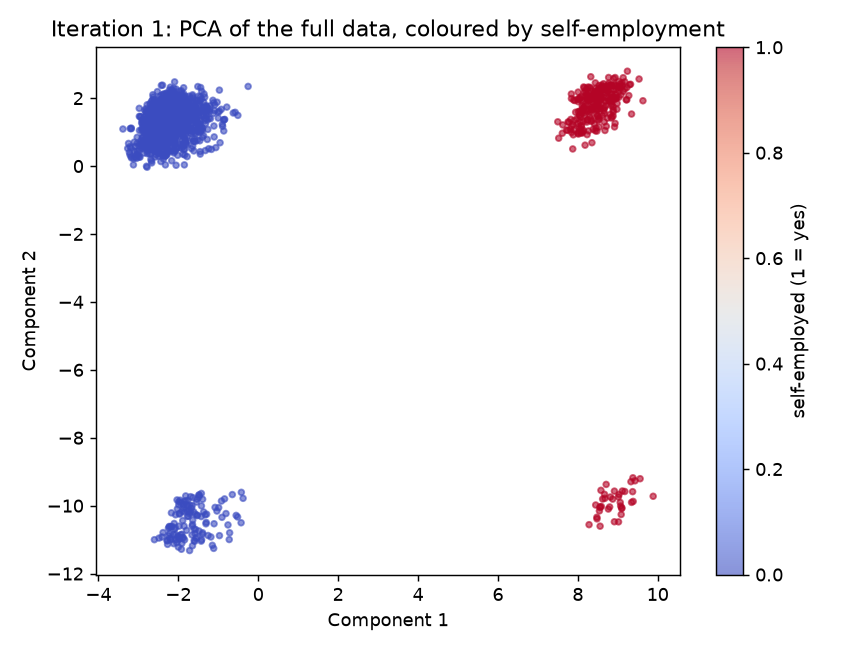
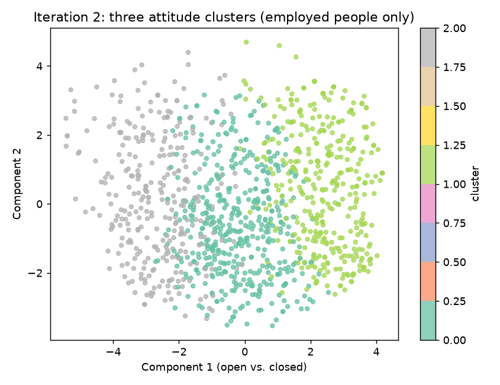
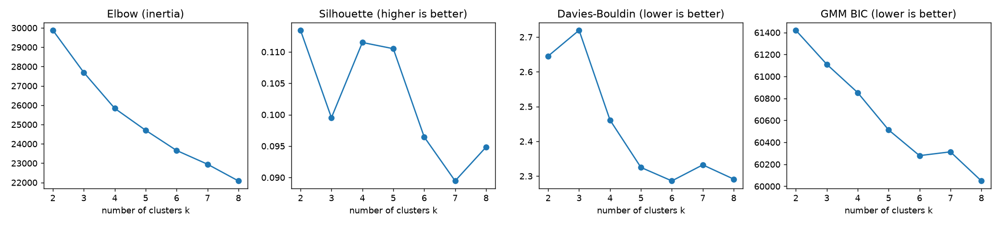
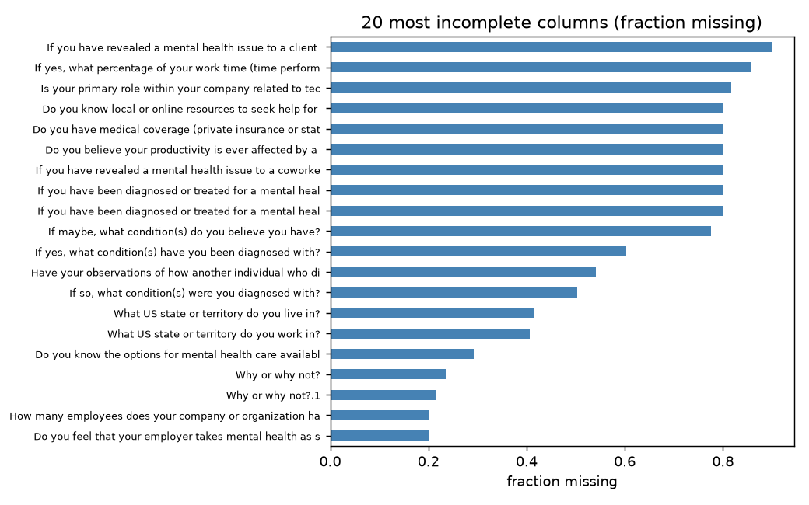
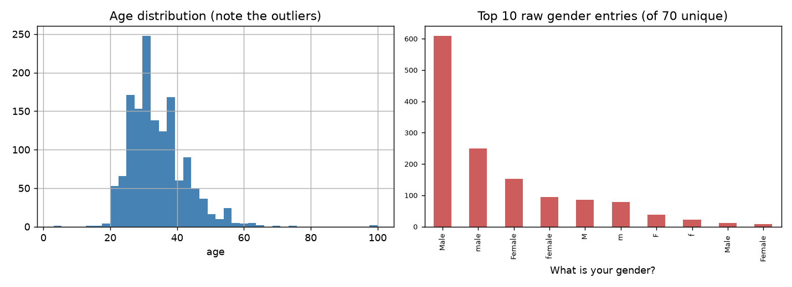

<div align="center">

# Clustering Mental-Health Survey Responses in Technology Jobs

### Unsupervised learning for an actionable HR mental-health programme

[](https://www.python.org/)
[](https://pandas.pydata.org/)
[](https://scikit-learn.org/)
[](https://numpy.org/)
[](https://matplotlib.org/)


**DLBDSMLUSL01 · Machine Learning: Unsupervised Learning and Feature Engineering**  
IU International University of Applied Sciences

</div>

---

## 🧭 Overview

Can a high-dimensional workplace survey be transformed into a small number of meaningful employee profiles that Human Resources can act on?

This repository answers that question using the **OSMI Mental Health in Tech Survey 2016**. The raw data contains **1,433 respondents and 63 mostly categorical questions**, with substantial missingness, non-standardised text, implausible values, and survey-routing effects.

The analysis deliberately keeps the complete modelling story visible: an initially convincing clustering solution is rejected after it is shown to reproduce the survey structure rather than employee attitudes. A refined second iteration then focuses on the employed population and a smaller set of workplace-attitude features.

> **Core outcome:** three interpretable groups among **1,146 employed respondents** — **Closed & fearful**, **Uncertain**, and **Open & supported**.

### At a glance

| Question | Answer |
|---|---|
| **What is categorised?** | Employed survey participants, based on workplace mental-health attitudes and experiences |
| **How is complexity reduced?** | PCA for visualisation, after cleaning and one-hot encoding |
| **Which clustering methods are compared?** | k-Means and Gaussian Mixture Models (GMM) |
| **How is `k` assessed?** | Inertia, silhouette score, Davies–Bouldin index, and GMM BIC |
| **What makes the result useful?** | Each cluster maps to a distinct HR intervention strategy |

---

## ⚙️ Analytical Pipeline

<div align="center">

**🔍 Explore → 🧹 Preprocess → 🧪 Baseline → 🔎 Diagnose → 🔁 Refine → 📊 Profile → 🧠 Act**

</div>

| Stage | Script | Purpose | Main outputs |
|---:|---|---|---|
| 1 | [`00_exploration.py`](00_exploration.py) | Inspect missingness, data types, invalid ages, raw gender values, and high-cardinality text | `eda_missingness.png`, `eda_age_gender.png` |
| 2 | [`01_preprocessing.py`](01_preprocessing.py) | Clean, engineer, and encode the survey into a numeric feature matrix | `preprocessing_report.txt` |
| 3 | [`02_first_iteration.py`](02_first_iteration.py) | Build a deliberately simple PCA + k-Means baseline | `fig_iter1_pca.png` |
| 4 | [`03_refined_iteration.py`](03_refined_iteration.py) | Restrict the population and feature set, compare models, and profile the final clusters | `fig_iter2_selection.png`, `fig_iter2_clusters.png`, `cluster_profiles_employed.txt` |

<details>
<summary><strong>How the repository addresses the case-study requirements</strong></summary>

| Requirement | Implementation |
|---|---|
| Explore the available data | Missingness, data types, invalid ages, non-standardised gender entries, and high-cardinality text fields |
| Prepare and process the data | Structural missingness, age correction, gender standardisation, categorical encoding, and feature engineering |
| Reduce dimensionality | Principal Component Analysis (PCA) for compact visual interpretation |
| Categorise participants | k-Means clustering, compared with a Gaussian Mixture Model |
| Interpret each cluster | Cluster sizes, response profiles, disclosure comfort, expected consequences, and employer support |
| Identify points of leverage | Targeted recommendations for HR based on each group’s needs |
| Critically assess each step | A failed first iteration is diagnosed and used to redesign the feature space |

</details>

---

## 🧪 Iteration 1: A Useful Failure

The initial model used the complete encoded feature matrix. It produced visually distinct groups, but the separation was driven mainly by **employment status and survey routing**, not by mental-health attitudes.

Explicit `Not applicable` values correctly preserved structural missingness. However, they also dominated the principal components because self-employed respondents were not shown many employer-related questions.



This result was rejected rather than presented as meaningful. The diagnosis led to four corrections:

1. restrict the analysis to **1,146 employed respondents**, the population relevant to the HR scenario;
2. cluster only on **12 focused attitude and workplace-experience questions**;
3. remove demographic and survey-routing variables from the clustering geometry;
4. keep demographic fields only for post-cluster description.

> **Lesson:** clean preprocessing can still produce misleading clusters when the feature space represents questionnaire mechanics instead of the phenomenon of interest.

---

## 🎯 Final Result

The refined model uses **k-Means with `k = 3`**. The value was selected for interpretability and operational usefulness rather than because one diagnostic identified a unique mathematical optimum.

| Cluster | Size | Defining pattern | HR interpretation |
|---|---:|---|---|
| **🔒 Closed & fearful** | **305** | 7% are comfortable telling a supervisor; 61% expect negative consequences | Affected but silent; needs trust, confidentiality, and credible protection from retaliation |
| **❔ Uncertain** | **459** | Answers are dominated by “Maybe” and “I don’t know”; 61% are unsure whether the employer takes mental health seriously | The largest and most movable group; needs clarity, visible processes, and repeated communication |
| **🤝 Open & supported** | **382** | 89% are comfortable telling a supervisor; 87% expect no negative consequences; 68% believe the employer takes mental health seriously | A positive internal reference group whose practices can be identified and replicated |

### Cluster visualisation



The groups form a continuous structure rather than isolated islands. This is consistent with workplace attitudes grading into one another, particularly along the first principal component. The GMM comparison reinforces that interpretation by identifying a small set of respondents whose membership is genuinely uncertain.

---

## 📐 Choosing the Number of Clusters



Silhouette score mildly favours `k = 2`, while the Davies–Bouldin index and BIC improve at larger values. Three clusters were retained because they are reasonably balanced and tell three distinct, actionable stories without creating overly fragmented profiles.

<details>
<summary><strong>View the complete diagnostics table</strong></summary>

| k | Inertia | Silhouette | Davies–Bouldin | GMM BIC |
|---:|---:|---:|---:|---:|
| 2 | 29,878 | 0.113 | 2.65 | 61,421 |
| **3** | **27,695** | **0.100** | **2.72** | **61,111** |
| 4 | 25,838 | 0.111 | 2.46 | 60,853 |
| 5 | 24,704 | 0.111 | 2.32 | 60,514 |
| 6 | 23,661 | 0.096 | 2.29 | 60,279 |
| 7 | 22,949 | 0.089 | 2.33 | 60,314 |
| 8 | 22,085 | 0.095 | 2.29 | 60,049 |

</details>

> `k = 3` is a defensible modelling decision, not a claim that the data has one uniquely correct partition.

---

## 🧠 Points of Leverage for HR

### 🔒 Closed & fearful — establish psychological safety first

General awareness campaigns are unlikely to reach employees who believe disclosure may harm them. Priority measures are confidential access routes, explicit non-retaliation commitments, consistent manager behaviour, and visible evidence that seeking support does not damage careers.

### ❔ Uncertain — remove ambiguity

This group appears more uninformed than openly resistant. HR can address it through plain explanations of available support, confidentiality boundaries, escalation routes, and concrete examples of how the process works.

### 🤝 Open & supported — learn from existing good practice

This group is not the primary intervention target. It can help identify teams, managers, and communication practices that already create safety and trust, allowing successful behaviours to be reproduced elsewhere.

---

## 🔍 Data Exploration

<table>
<tr>
<td width="50%" valign="top">

**Missingness and survey routing**



</td>
<td width="50%" valign="top">

**Age and gender quality checks**



</td>
</tr>
</table>

Key observations:

- only **19 of 63 columns** are complete;
- much of the missingness is structural rather than random;
- **287 self-employed respondents** correspond exactly to 287 missing answers in an employer-only question;
- age includes implausible entries such as `3`, `99`, and `323`;
- gender is free text with **70 distinct raw spellings**;
- several open-text questions contain more than 1,000 unique responses and are outside this categorical clustering pipeline.

---

## 🚀 Installation and Usage

### 1. Clone the repository

```bash
git clone https://github.com/ApteryxDev/iu-mlusl-mental-health.git
cd iu-mlusl-mental-health
```

### 2. Create a virtual environment

<details open>
<summary><strong>macOS / Linux</strong></summary>

```bash
python3 -m venv .venv
source .venv/bin/activate
python -m pip install --upgrade pip
pip install -r requirements.txt
```

</details>

<details>
<summary><strong>Windows PowerShell</strong></summary>

```powershell
py -m venv .venv
.venv\Scripts\Activate.ps1
python -m pip install --upgrade pip
pip install -r requirements.txt
```

</details>

### 3. Add the dataset

Download the OSMI 2016 survey and place the CSV at the exact path expected by the scripts:

```text
task1_data/mental-heath-in-tech-2016_20161114.csv
```

> The spelling `mental-heath` is intentional and matches the original dataset filename.

### 4. Run the complete workflow

```bash
python 00_exploration.py
python 01_preprocessing.py
python 02_first_iteration.py
python 03_refined_iteration.py
```

Run the scripts in order because later stages use files created during preprocessing.

---

## 🗂️ Repository Structure

```text
iu-mlusl-mental-health/
├── 00_exploration.py             # descriptive analysis and data-quality checks
├── 01_preprocessing.py           # cleaning, feature engineering, and encoding
├── 02_first_iteration.py         # full-matrix baseline and failure diagnosis
├── 03_refined_iteration.py       # focused clustering, selection, and profiling
├── requirements.txt
├── task1_data/
│   └── mental-heath-in-tech-2016_20161114.csv   # downloaded separately
├── eda_missingness.png
├── eda_age_gender.png
├── fig_iter1_pca.png
├── fig_iter2_selection.png
├── fig_iter2_clusters.png
├── preprocessing_report.txt
└── cluster_profiles_employed.txt
```

---

## 🧰 Built With

| Tool | Role in the project |
|---|---|
| **Python 3.10+** | Analysis and reproducible workflow |
| **pandas** | Survey loading, cleaning, and tabular transformations |
| **NumPy** | Numerical operations |
| **scikit-learn** | Encoding, scaling, PCA, k-Means, GMM, and model diagnostics |
| **Matplotlib** | Exploratory and cluster visualisations |

---

## ⚠️ Methodological Limitations

- The survey is self-selected and geographically skewed, so the clusters describe this sample rather than all technology employees.
- Demographics are excluded from clustering to prevent them from defining the geometry, but they can still be used cautiously for profiling.
- `k = 3` is interpretable and useful, but not unique.
- One-hot encoded categorical features can introduce geometric artefacts; a categorical-native method such as k-modes would be a useful robustness check.
- Cluster labels are descriptive summaries, not diagnoses.
- The analysis identifies associations and group patterns, not causal effects.
- Stability should be tested across random seeds and question subsets before operational use.

---

## 📚 Data Source

Open Sourcing Mental Illness (OSMI), **Mental Health in Tech Survey 2016**  
https://www.kaggle.com/osmi/mental-health-in-tech-2016

---

<div align="center">

Built for **IU International University of Applied Sciences**  
B.Sc. Applied Artificial Intelligence · DLBDSMLUSL01

**Alp Ege Yalcin · Matriculation No. 42308653**

</div>
